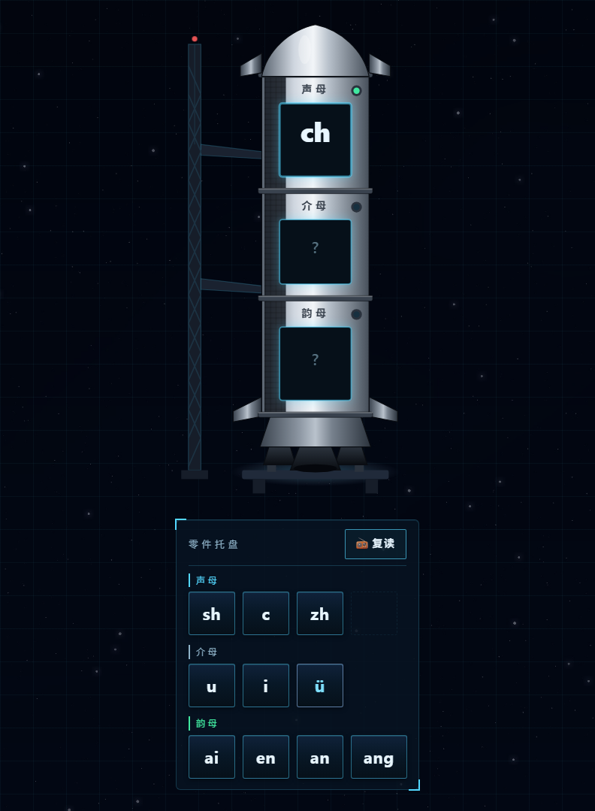
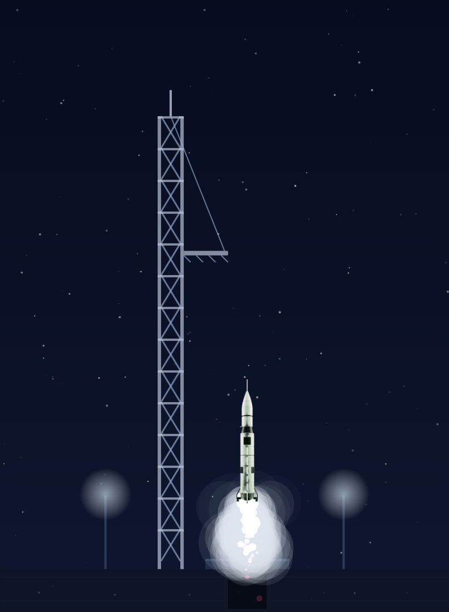
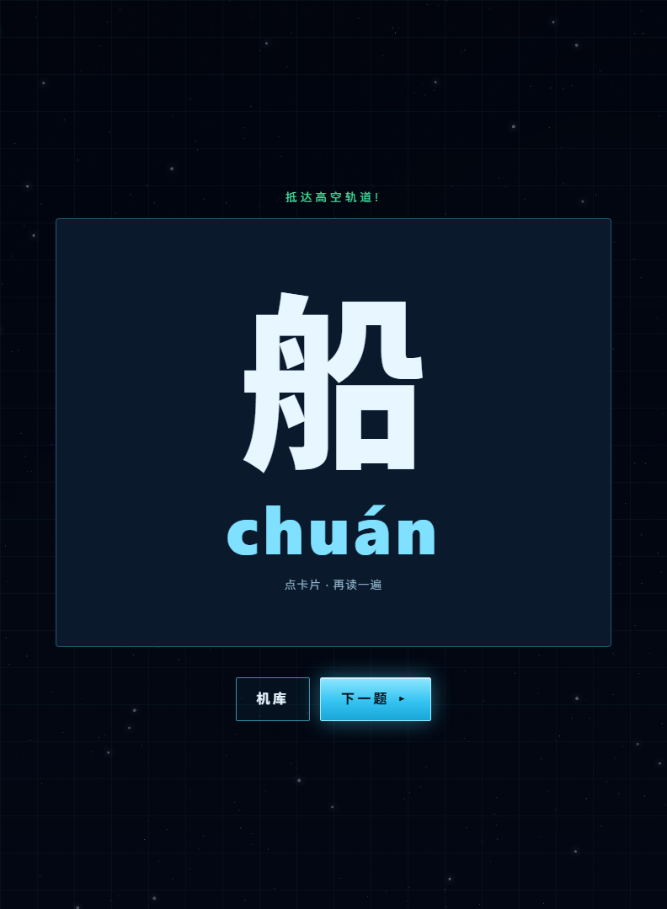
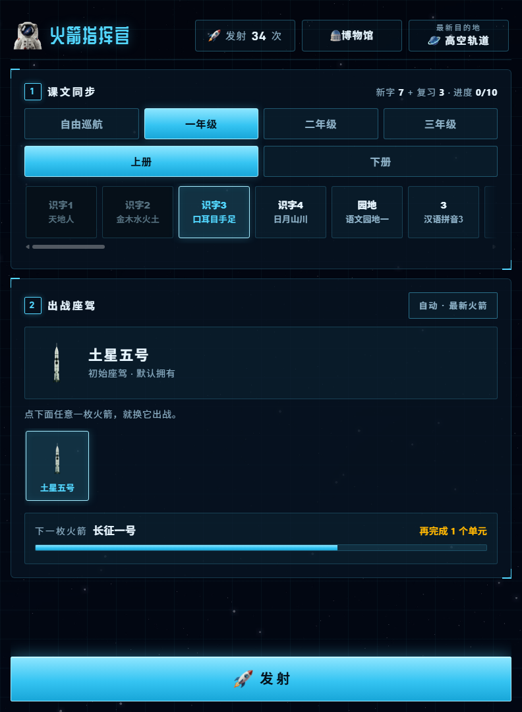
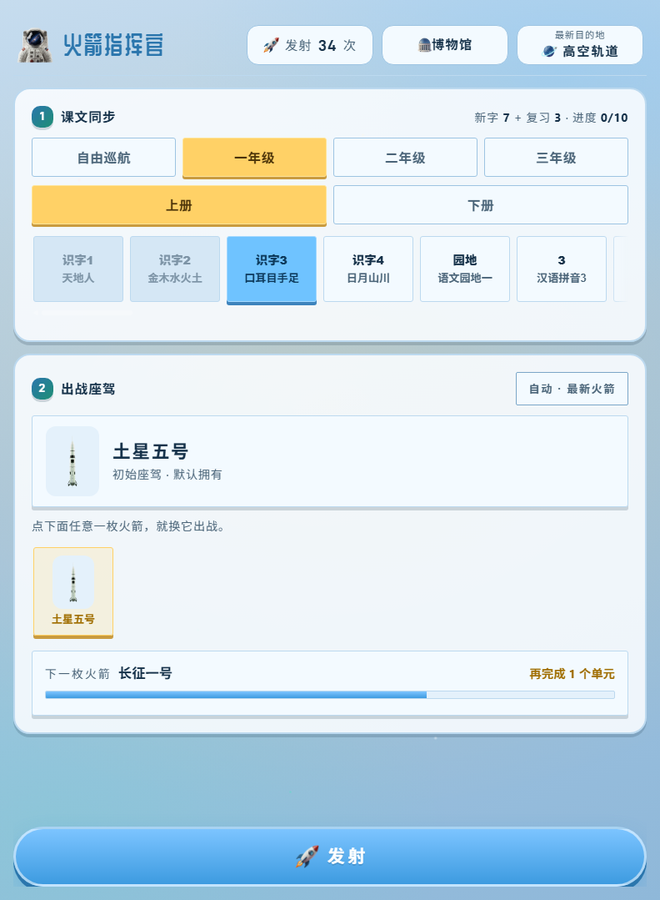
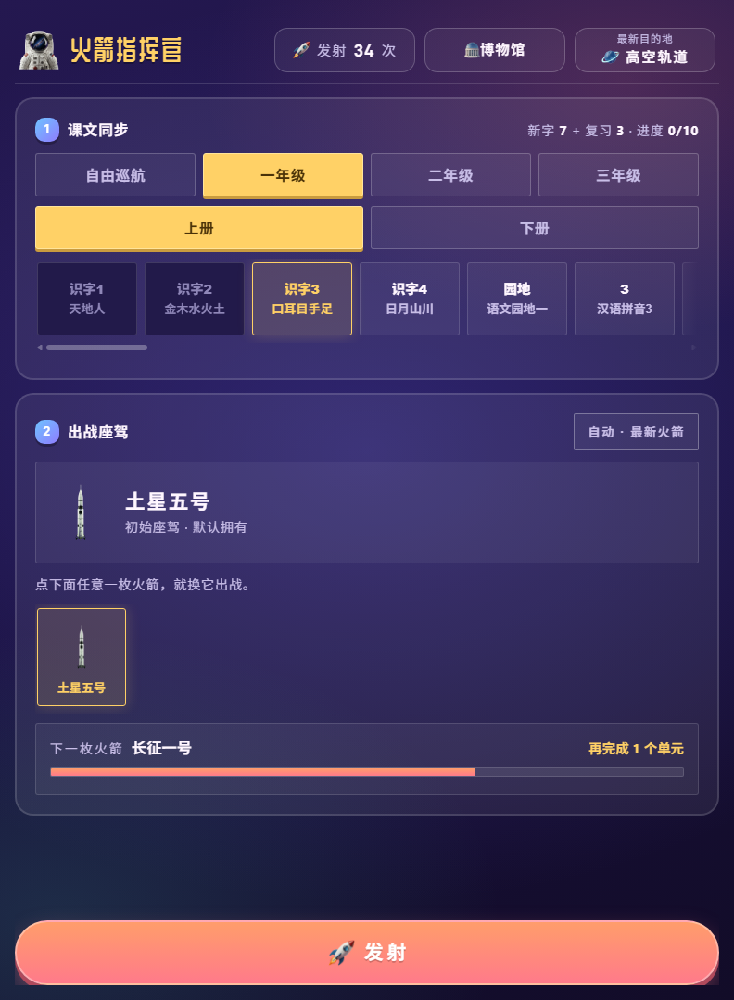

# 星际发射指挥官 · StarPinyin Commander

**一款紧扣统编版语文课文的拼音发射网页游戏。** 孩子拼对一个字的拼音，火箭才能点火升空，飞到课本奖励的星球。打开就能玩：不用注册、不用联网、不装 App；iPad、电脑、手机都行。主打小学 1~3 年级（约 6~9 岁）。

## 课本同步

- **版本**：统编版（人教版）语文 · **2024 年修订版**（2024 秋一年级启用、2026 秋全面覆盖），即当前全国在用的最新版。
- **来源与组织**：一~三年级 6 册、206 课；生字取课本的**识字表（会认）∪ 写字表（会写）**，字数与课本页脚逐一核对一致；按课本真实学习顺序编排，每字落在首次教学的那一课，多音字按该课语境读音入库。
- **紧扣课本**：只从「学到哪一课」为止**累计学过的字**里抽题，不超纲；每题标明出处（如「📖 一年级上册 · 识字2《金木水火土》」）。

## 主要功能

- **拼音发射**：听读音 → 拖声母/韵母组装火箭 → 校准声调 → 点火飞向星球，一局 40~60 秒；拼错两次零件自动发光提示，`j q x` 遇 `ü` 有「摘两点」彩蛋。
- **跟着课本一课一课走**：点一课生成固定题单（本课新字 + 过往字复习，错题优先）；完成课时解锁 **14 个星际目的地、16 枚火箭**。
- **专项训练**：三拼音节、易混音（平翘舌、前后鼻音、`n`/`l`、`j q x`+`ü`）特训；家长可注入孩子今天课上写错的字优先练。
- **真人读音离线**：内置 957 个真人录音音节，断网可玩；整句提示语可在后台配置合成。
- **家长后台**（`/admin.html`）：错题注入、薄弱音统计、词库管理、皮肤切换，带儿童锁。

## 界面展示

| 火箭组装 | 点火发射 | 卡片认读 |
|---|---|---|
|  |  |  |

| A · 深空座舱 | B · 天空积木 | C · 星云乐园 |
|---|---|---|
|  |  |  |

三套皮肤，家长后台一键切换，共用同一份进度与词库。

## 安装

零依赖，装好 [Node.js](https://nodejs.org)（18+）后：

```powershell
npm start
```

浏览器打开 `http://127.0.0.1:3000` 即玩。iPad：连与电脑**同一 WiFi**，用 Safari 打开控制台打印的局域网地址，「添加到主屏幕」即可像 App 一样使用（首次启动请允许 Windows 防火墙提示）。

## 了解更多

- 技术细节（词库规则、课文同步、API、语音链路）：[docs/技术细节.md](docs/技术细节.md)
- 设计文档、版本演进与下一步迭代计划：[star-pinyin.md](star-pinyin.md)
- 开发者：原生 Node.js + 原生 HTML/CSS/ES Modules，无构建步骤；`npm test` 跑全部测试。